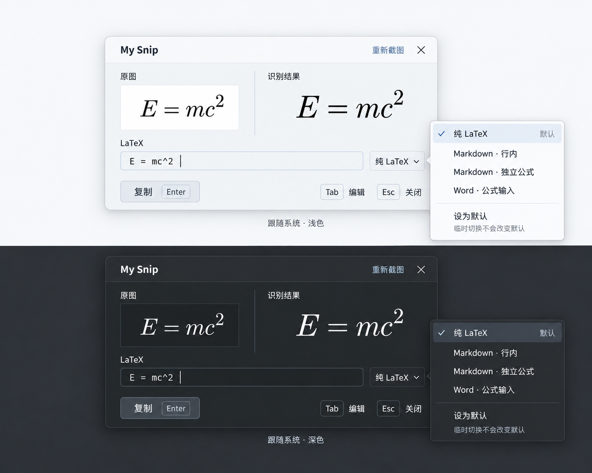
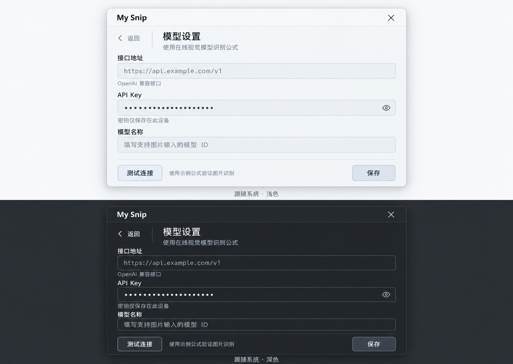

# My Snip 第一版产品设计

My Snip 是个人使用的公式截图工具。核心场景是在阅读论文时用快捷键框选公式，通过在线多模态模型识别，检查结果后复制到写作软件。结果窗口采用紧凑的键盘速览布局，复制成功后自动收起并返回截图前的应用。

更新日期：2026 年 10 月 18 日。当前交付为设计说明和视觉稿，尚未实现桌面截图、模型请求或剪贴板功能。

已确认采用 C 方案：Tauri 2，支持 Windows 和 macOS。Rust 核心常驻托盘，WebView 按需创建；复制成功后收起并销毁结果界面，避免长期保留隐藏的浏览器界面。具体实现见[系统设计](docs/SYSTEM-DESIGN.md)。

## 已确定的产品范围

| 项目 | 设计决定 |
| --- | --- |
| 平台 | Windows 和 macOS；两平台分别进行真实验收 |
| 桌面架构 | Tauri 2 与 Rust，界面按需创建并在使用结束后销毁 |
| 核心输入 | 快捷键框选屏幕中的公式 |
| 识别方式 | 在线多模态 LLM，使用 OpenAI 兼容接口 |
| 模型配置 | 自定义接口地址、API Key 和模型名称 |
| 结果窗口 | 紧凑浮窗，截图预览与排版结果并排，下方可编辑 LaTeX |
| 界面风格 | 中性灰，随系统切换明暗，按钮采用接近窗口底色的柔和灰色 |
| 暗色截图预览 | 深底浅字，仅处理显示，识别使用原始截图 |
| 输出格式 | 纯 LaTeX、Markdown 行内、Markdown 独立公式、Word 公式输入 |
| 默认格式 | 用户显式设定并持久保存，每次识别可临时切换 |
| 复制之后 | 剪贴板写入成功才自动收起，返回原来的应用 |
| 待机行为 | 仅保留托盘、快捷键和必要状态，不保留结果或设置 WebView |

第一版围绕一次截图和一次复制展开。整篇 PDF 转换、本地离线模型、笔记库和跨设备同步属于后续扩展。

## 使用流程

1. 首次使用时填写接口地址、API Key 和支持图片输入的模型名称，使用示例公式测试识别。
2. 按全局截图快捷键，拖动框选公式；按 Esc 取消。
3. 保存原始截图并提交识别，浮窗显示截图预览和“正在识别”。
4. 收到有效公式后显示排版预览和可编辑 LaTeX，载入用户的默认输出格式。
5. 用户检查公式，必要时修改代码或临时切换输出格式。
6. 按 Enter 或点击“复制”。复制成功后收起窗口，销毁结果 WebView，并在系统允许时恢复之前应用的焦点，由用户执行粘贴。

识别失败、取消或复制失败时，不覆盖现有剪贴板。失败状态保留截图，供用户重试或重新框选。

## 结果窗口

主窗口由四个区域组成：标题栏、截图与公式对照区、代码编辑区和操作区。标题栏保留重新截图与关闭；模型设置可由工具入口打开。截图预览支持查看完整公式，公式较长时允许滚动或扩大窗口，不截断内容。

托盘提供“截图”“设置”“退出”。设置和识别结果共用一个工作窗口，页面间切换时将必要状态保存在 Rust 中；截图遮罩与工作窗口分阶段使用。关闭工作窗口返回托盘，“退出”才结束整个应用。

代码区编辑规范化的 LaTeX。输出格式仅决定复制时如何包装或转换，不直接改写编辑区中的公式。修改代码后同步更新排版预览；渲染失败时保留代码并标明问题，允许继续编辑。

截图经过主题显示处理后，左侧标签采用“截图预览”。深色主题下该预览使用深底浅字；修改只作用于显示，识别始终使用原始截图。

### 系统明暗主题

| 元素 | 浅色主题 | 深色主题 |
| --- | --- | --- |
| 窗口底色 | `#F5F6F7` | `#272B2F` |
| 代码区 | `#EFF1F3` | `#212529` |
| 主要文字 | `#2A3036` | `#DCE1E5` |
| 主按钮底色 | `#E4E9EE` | `#353B42` |
| 主按钮文字 | `#344451` | `#D4DEE7` |
| 主按钮边框 | `#C7D0D9` | `#515D69` |
| 截图预览与公式预览 | 浅底深字 | 深底浅字 |

界面在系统主题变化时即时更新。主按钮通过位置、字重、边框和悬停状态体现优先级；深色主题避免白色大按钮，浅色主题避免黑色大按钮。聚焦、悬停、禁用状态也要保持可辨认。

原始截图文件与发送给模型的图片始终保留采集时的像素。只对截图预览进行主题适配，避免把显示反色处理写回图片，或对原本已是深底浅字的截图重复反色。第一版优先覆盖黑白及灰度公式截图。

### 键盘操作

| 状态 | 操作 | 行为 |
| --- | --- | --- |
| 任意应用 | 可配置全局快捷键 | 开始框选截图；注册冲突时提示修改，Mac 使用对应平台修饰键 |
| 截图框选 | Esc | 取消截图并返回原应用 |
| 结果预览 | Enter | 按当前格式复制，成功后收起 |
| 结果预览 | Tab | 进入代码编辑，随后按正常焦点顺序导航 |
| 代码编辑 | Enter | 作为编辑操作处理，不意外触发复制 |
| 代码编辑 | Ctrl + Enter 或 Mac 的 Command + Enter | 复制并收起 |
| 格式菜单 | 方向键与 Enter | 选择格式，完成后回到结果预览 |
| 结果窗口 | Esc | 优先关闭菜单；再次按 Esc 取消会话、收起并销毁窗口 |

中文输入法处于组词状态时，Enter 只确认输入，不触发复制。截图快捷键的具体默认键位由实现阶段设定，并允许修改。

## 窗口生命周期

启动时不预建隐藏的 WebView。触发截图后仅为当前显示器创建临时遮罩；选区提交或取消后销毁遮罩。识别阶段再创建工作窗口，复制成功、取消或关闭时销毁该窗口。

销毁窗口前取消相关请求、撤销图片访问令牌并释放图像及监听器。系统 WebView 辅助进程与缓存的实际回收需要在双端实测，不把调用销毁接口直接记为内存达标。

## 输出格式和默认偏好

| 菜单项 | 示例或用途 |
| --- | --- |
| 纯 LaTeX | `E = mc^2` |
| Markdown · 行内 | `$E = mc^2$` |
| Markdown · 独立公式 | 用成对的 `$$` 包围公式，并保留独立行 |
| Word · 公式输入 | 输出适配 Word 公式框的输入文本 |

菜单分别标示“本次选择”和“默认格式”。临时切换只影响当前结果；点击“设为默认”同时更新本次选择和持久偏好。下次截图重新载入默认格式，而不是沿用上次临时选择。首次默认暂定为纯 LaTeX，用户可随时修改。

复制按钮使用通用文案“复制”，避免选择 Word 或 Markdown 后仍标为“复制 LaTeX”。当前选择的格式在按钮附近持续可见。

选择 Word 时，提供“粘贴到 Word 公式框”的简短提示。第一版输出适配公式框的线性文本；原生可编辑富文本复制属于后续扩展。Word 的 LaTeX 支持存在语法差异，常用表达式需要在实际 Windows 和 Mac 的 Word 版本中分别验证。参考：[微软公式输入说明](https://support.microsoft.com/en-us/word/linear-format-equations-using-unicodemath-and-latex-in-word)。

## 在线模型设置

日常配置只展示当前使用的接口。第一版采用 OpenAI 兼容的图文请求形式，模型名称允许手动输入，不要求服务必须提供模型列表。

| 设置项 | 行为 |
| --- | --- |
| 接口地址 | 填写服务基础地址；校验地址格式 |
| API Key | 默认遮挡，允许临时显示；在本机安全保存 |
| 模型名称 | 手动填写支持图片输入的模型 ID |
| 测试连接 | 实际提交示例公式图片，检查是否返回可用的识别结果 |
| 保存 | 保存配置，后续识别使用当前配置 |

测试与识别只向用户配置的服务提交图片。密钥不进入项目文档、版本控制、普通日志或错误提示；Rust 通过系统凭据存储保存，分别对接 Windows Credential Manager 和 macOS Keychain。读取已保存配置时不把明文密钥回填到界面。

模型只负责图片到 LaTeX 的识别，不进行解题或解释。应用负责清理代码块等响应包装、验证结果非空、渲染预览及输出格式转换。若返回解释性文字或不可用内容，进入识别失败状态，不能将其当作公式成功展示。

接口自称兼容并不等于模型支持图片，因此“测试连接”需要验证实际图片输入。测试成功状态只对应本次地址、密钥和模型组合；修改任一项后，该状态失效。

## 异常和恢复

| 状态 | 用户看到的内容 | 可执行操作 |
| --- | --- | --- |
| 尚未配置 | 配置接口后开始识别 | 打开模型设置 |
| 截图权限未获准 | 说明当前平台需要的权限 | 引导用户授权后重新截图 |
| 正在识别 | 截图预览和识别状态 | 取消请求、关闭窗口 |
| 密钥或访问权限错误 | 检查 API Key 或服务权限 | 修改配置后重试 |
| 模型不支持图片 | 选择支持图片输入的模型 | 修改模型后重试 |
| 网络或超时错误 | 连接失败，截图已保留 | 重试、修改接口、重新截图 |
| 返回为空或内容不可用 | 未获得可用公式 | 重试或重新截图 |
| 排版失败 | 保留可编辑代码并标出问题 | 修改代码、重试识别 |
| 复制失败 | 保留结果并提示重试 | 再次复制 |

关闭窗口或开始新截图时，取消旧请求或忽略旧响应，避免迟到的结果覆盖新截图。失败重试由用户触发，避免在无提示的情况下反复调用付费接口。

## 第一版验收

以下条目是首版验收标准。当前 Windows 已完成工程构建与原生闭环测试；实际执行证据、内存数字和尚未验证的项目见 [验证记录](docs/VALIDATION.md)，不据此声称双平台全部验收完成。

- 能在实际桌面应用上用全局快捷键框选公式，并验证不同屏幕缩放下的截图区域。
- Windows 和 macOS 分别验证截图权限、系统主题、输入法、快捷键及焦点恢复，记录实际测试的系统和硬件。
- 配置真实的 OpenAI 兼容多模态服务后，能识别分式、上下标、积分和矩阵等代表性公式；截图与返回结果能够对照检查。
- 系统明暗变化同步影响窗口、菜单、按钮、截图预览和排版结果；发送给模型的原图不被显示处理改变。
- 编辑代码能更新排版预览；编辑态和输入法确认操作不会意外复制或关闭。
- 四种输出可分别粘贴到目标应用验证，Word 在其公式框和对应输入模式中检查。
- 临时选择与持久默认格式行为一致，重启后仍保留默认偏好。
- 只有复制成功才自动收起并恢复原应用焦点；网络、识别及剪贴板失败可恢复。
- 测试连接实际验证图片输入，错误信息不暴露密钥；真实接口和桌面行为需独立验收，不能只以视觉原型替代。
- 复制或取消后销毁临时 WebView，记录收起后 30 秒与 120 秒的应用及相关辅助进程内存；内存评估中的范围不作为已经达到的指标。

视觉稿由内置 ImageGen 根据本次已选方案生成，分别展示结果窗口、格式菜单和模型设置。实现以本说明中的最新行为约定为准。
