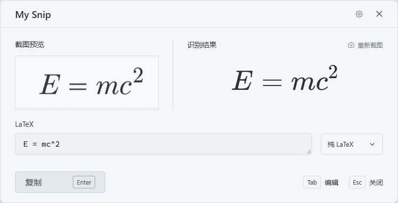
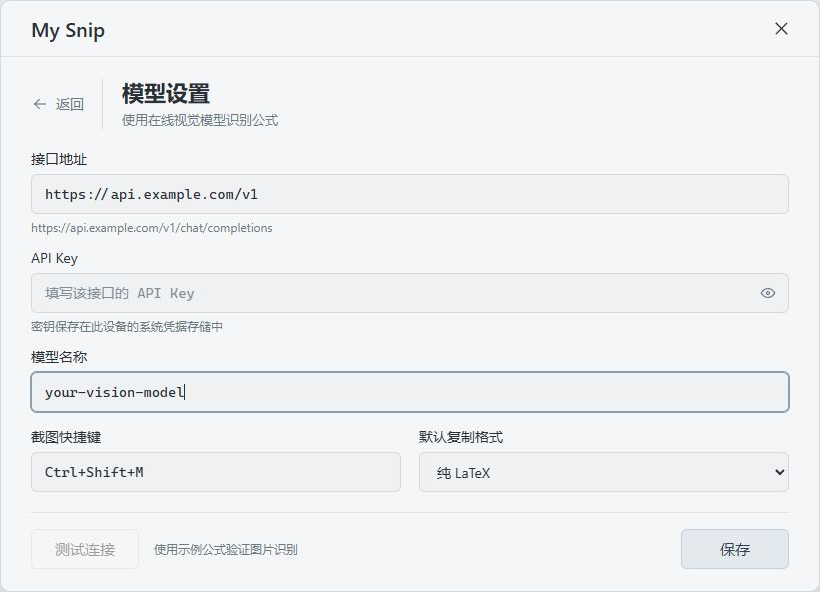
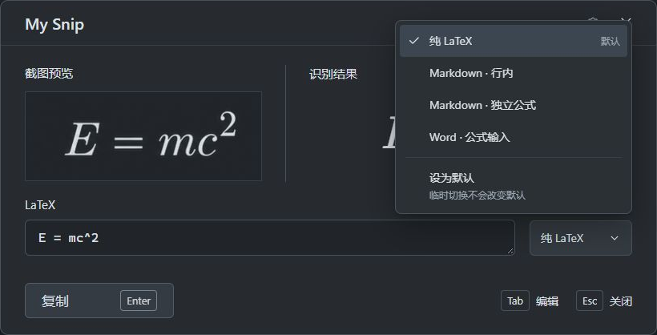
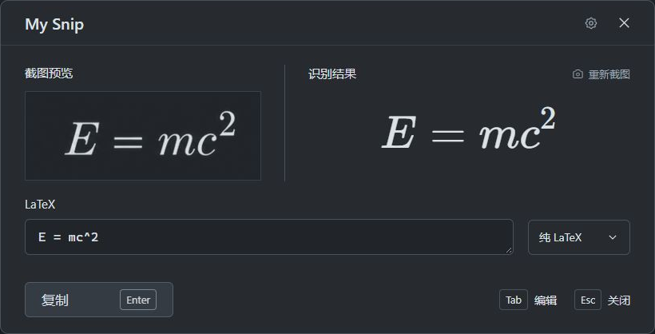

# My Snip

**截图取公式，复制到你的文稿里。**

读论文、记笔记、写报告时，按快捷键框选屏幕上的公式，转成可编辑的 LaTeX。对照原图检查，必要时修改，再复制到 LaTeX 文稿、Markdown 笔记或 Word 公式框。



*实际界面截图，使用示例公式；下文设置截图中的地址与模型名称也仅作示意。*

## 能做什么

- **随手截图**：在 PDF、网页或其他应用中框选公式，松开鼠标后开始识别。
- **边检查边修改**：原图与排版结果并排显示，修改 LaTeX 后同步预览；长公式和高分式自动适应预览区域。
- **按需复制**：支持纯 LaTeX、Markdown 行内、Markdown 独立公式和 Word 公式输入文本，可设置常用的默认格式。
- **复制后自动收起**：复制成功后返回写作流程；需要时从托盘重新打开。
- **使用自己的模型**：填写 OpenAI 兼容接口、API Key 和支持图片输入的模型，按所选服务的规则计费。

## 安装

当前版本为 **0.1.1**，提供 Windows 安装包和免安装版。**macOS 版尚未发布。**

| 文件 | 使用方式 |
| --- | --- |
| `My-Snip-0.1.1-x64-setup.exe` | 双击安装，适合日常使用 |
| `My-Snip-0.1.1.exe` | 直接运行，适合先试用 |

本次交付的安装文件位于 `output/` 目录。若拿到的是源码，请参阅[开发与构建说明](docs/DEVELOPMENT.md)。

Windows 版需要 WebView2 Runtime，安装包会检测并引导安装。更新时先从托盘退出旧版，再安装或打开新版，原有接口配置和默认格式会保留。

## 第一次使用

### 1. 配置模型

首次打开会进入设置页。准备好你使用的模型服务提供的三个信息：

| 设置项 | 填什么 |
| --- | --- |
| 接口地址 | 服务商提供的 OpenAI 兼容地址，例如 `https://api.example.com/v1` |
| API Key | 该服务的密钥 |
| 模型名称 | 支持图片输入的模型 ID，以服务商提供的名称为准 |



填好后点 **测试连接**，核对返回的示例公式，再点 **保存**。测试会发送内置示例图，也可能产生服务费用。兼容接口不代表所有模型都能看图，需要选择支持图片输入的模型。

地址可以填写基础路径，也可以填写完整的 `/chat/completions` 地址；自定义网关路径会保留。远程接口使用 HTTPS，本机 `localhost` 服务可以使用 HTTP。

### 2. 框选公式

按 **Ctrl + Shift + M**，在鼠标所在的显示器上拖出选区，尽量只框住需要的公式。松开鼠标后等待结果。

### 3. 检查并复制

对照左侧原图与右侧结果。符号不对时直接修改下方 LaTeX，预览会同步更新。选择输出格式，按 **Enter** 复制，再到目标应用粘贴。

正在编辑代码时，**Enter** 用于换行，**Ctrl + Enter** 才会复制。复制成功后窗口自动收起；按 **Esc** 可以取消。

## 三个常见用例

### 读论文，把公式放进 LaTeX 文稿

在 PDF 中框选公式，检查上下标、分子和分母，选择 **纯 LaTeX** 后复制。例如：

```latex
E = mc^2
```

将它放入文稿已有的数学环境中，继续编辑或排版。

### 记 Markdown 笔记，省去重复输入

正文中的短公式选择 **Markdown · 行内**，复制后得到 `$E = mc^2$`；需要单独成行时，选择 **Markdown · 独立公式**：

```markdown
$$
E = mc^2
$$
```

粘贴到支持数学公式的 Markdown 编辑器中即可。常用哪一种，就在格式菜单中点 **设为默认**；临时切换只影响这一次复制。



### 写 Word 报告，把公式放进公式框

选择 **Word · 公式输入** 并复制，在 Word 中插入公式、切换到 LaTeX 输入方式，再粘贴。

复制的是公式输入文本，需要放进公式框。Word 对部分矩阵和多行语法的支持存在差异；遇到不支持的环境时，可切换纯 LaTeX 后手动调整。

## 日常操作

| 操作 | Windows 快捷键 |
| --- | --- |
| 截图识别公式 | `Ctrl + Shift + M`，可在设置中修改 |
| 从预览进入编辑 | `Tab` |
| 在预览状态复制 | `Enter` |
| 编辑时复制 | `Ctrl + Enter` |
| 关闭菜单或取消当前操作 | `Esc` |

应用常驻系统托盘。关闭窗口后仍可用快捷键截图；要彻底退出，请打开托盘菜单，选择 **退出 My Snip**。

## 跟随系统明暗

界面、公式和截图预览会随系统主题变化。暗色模式下，截图默认以深底浅字显示；鼠标移到截图右下角，可以切换查看原色。发送给模型的图片保持原色。



## 图片和密钥如何处理

只有你框选的图片会被发送到当前配置的模型服务；测试连接发送的是内置示例图。识别准确性、图片的服务端处理和费用取决于所选服务，请在复制前核对结果。

API Key 保存在设备的系统凭据存储中，设置页不会回填旧密钥。普通使用不保存截图或公式历史，也不包含云端同步。

## 常见问题

**快捷键没有反应？**

先确认 My Snip 仍在托盘中运行。若快捷键被其他应用占用，到设置中换一个组合键。

**接口连接失败，或提示模型不支持图片？**

检查接口地址、API Key 和模型 ID。模型必须同时支持该接口格式和图片输入；限流、额度不足或网络超时也会影响识别，可按提示修改设置或重试。

**公式识别有误？**

缩小截图范围，保证公式清晰完整，再识别一次。也可以保留截图，直接修改 LaTeX 并对照预览检查。

## 更多资料

[开发与构建](docs/DEVELOPMENT.md) · [验证记录](docs/VALIDATION.md) · [第三方许可](THIRD_PARTY_NOTICES.md)
