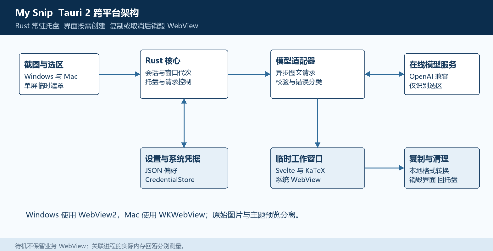

# My Snip 跨平台实现方案

更新日期：2026 年 10 月 18 日。用户已选择 C 方案，优先完成可使用版本。本文件是当前实现依据，Word 版同步导出；产品交互以 DESIGN.md 为准。目前完成的是设计整理，应用工程尚未搭建。

## 1 方案概述

采用 Tauri 2、Rust、Svelte、TypeScript、Vite 和 KaTeX。Rust 核心常驻，负责托盘、快捷键、截图、模型请求、剪贴板和设置；WebView 只在框选、预览或设置时创建，使用结束后销毁。Windows 与 macOS 共用业务逻辑和界面，平台能力通过适配器隔离。

应用直接调用用户配置的 OpenAI 兼容服务。模型只转写图片中的公式，本地负责校验、排版、编辑和格式转换。一次只处理一个活动截图会话；只在用户确认复制且剪贴板写入成功后收起界面。

Tauri 在 Windows 使用 WebView2，在 macOS 使用 WKWebView。销毁窗口是资源回收动作，不代表所有系统辅助进程立即退出；低待机内存需要在真实设备上验证。参考资料 1 和 2。

## 2 首版范围与技术栈

| 项目 | 首版决定 |
| --- | --- |
| 平台 | Windows 和 macOS，分别构建及验收 |
| 桌面框架 | Tauri 2；启动时不创建隐藏的 WebView |
| 界面 | Svelte 与 TypeScript，结果和设置复用一个工作窗口 |
| 核心 | Rust，异步网络与有界后台任务，不阻塞窗口事件循环 |
| 公式预览 | 本地打包的 KaTeX 与字体，编辑后更新预览 |
| 截图 | CaptureAdapter 优先验证 xcap，必要时替换平台后端 |
| 网络 | Rust HTTP 适配器，优先 reqwest，验证系统代理与超时行为 |
| 凭据 | CredentialStore 对接 Windows Credential Manager 与 macOS Keychain |
| 偏好 | 带版本的本地 JSON，原子保存 |
| 发布 | Windows 安装包与 Mac 应用包；Mac 原生构建并完成签名准备 |

第一版支持单屏框选、在线公式识别、手动修改、四种输出、默认格式、系统明暗、接口设置和连接测试。整篇 PDF、离线模型、历史库、跨设备同步、自动粘贴及 Word 原生富文本公式复制后续扩展。

Windows 优先覆盖 x64，Mac 覆盖 Apple Silicon，并安排 Intel 构建验证。最低系统版本以截图与凭据后端验证结果确定；不把框架支持范围直接当作整个应用的支持范围。

## 3 模块与责任边界

| 模块 | 主要职责 | 持有数据 | 失败时行为 |
| --- | --- | --- | --- |
| AppShell | 托盘 快捷键 窗口创建与销毁 | 窗口代次 退出标记 | 返回托盘 提示可恢复问题 |
| CaptureService | 屏幕匹配 冻结 选区裁切 | 临时整屏图和原始裁片 | 允许重截 不提交劣化图片 |
| SessionController | 状态机 请求代次 取消 | 当前会话与配置快照 | 废弃旧结果 保留可重试裁片 |
| VisionAdapter | 请求构造 响应处理 错误分类 | 请求期内的密钥和图片 | 用户显式重试 |
| Workbench | 公式预览 代码编辑 格式切换 | 当前显示所需的派生数据 | 保留可编辑文本 |
| SettingsStore | 偏好保存 凭据引用 模型设置 | 非密配置与系统凭据标识 | 保存失败保留旧配置 |
| DesktopAdapter | 剪贴板 焦点与权限适配 | 本次来源应用与窗口标识 | 复制失败不关闭 焦点尽力恢复 |

会话、请求和退出流程由 Rust 统一管理，不能把请求控制器或主要业务状态放在即将销毁的 WebView 中。界面重建后从 Rust 读取必要快照，不重新发起识别。

## 4 窗口和会话生命周期

主要状态为 dormant、selecting、recognizing、ready、copying 和 cleanup。识别失败保留会话与裁片；取消和关闭进入 cleanup，完成资源清理后回到 dormant。

| 阶段 | 存在的界面 | Rust 中保留的数据 | 结束动作 |
| --- | --- | --- | --- |
| dormant | 托盘或菜单栏 | 偏好 快捷键 必要服务 | 等待用户操作 |
| selecting | 当前屏幕的临时遮罩 | 冻结图 选择代次 来源窗口 | 提交或取消后销毁遮罩 |
| recognizing | 工作窗口显示截图与状态 | 裁片 请求任务 配置快照 | 成功进入 ready |
| ready | 工作窗口显示预览与编辑区 | 结果 会话代次 | 复制 修改 重试或关闭 |
| copying | 工作窗口短暂锁定复制动作 | 当前编辑快照和操作标识 | 写入成功后收起 |
| cleanup | 窗口已收起 | 仅待释放的资源 | 销毁 WebView 撤销令牌 释放图像 |

启动仅创建托盘和注册快捷键。触发截图前记录来源应用，隐藏自身工作窗口，冻结鼠标所在屏幕后再显示遮罩，避免把自己的界面截入图片。首版同时最多存在一个正在使用的遮罩或工作 WebView，不为全部显示器常驻创建界面。

复制成功后先收起，随后销毁工作窗口；取消、关闭和截图退出走同一清理入口。Rust 保留托盘与快捷键，不因最后一个窗口关闭而误退出；托盘“退出”设置明确退出标记，取消任务、注销快捷键并结束进程。参考资料 3。

窗口异步回调必须携带 windowGeneration。旧窗口的关闭、复制或请求回调不能销毁新窗口。清理期间的新截图操作排队为一次操作，避免连续按快捷键产生多个后台请求或残留窗口。

## 5 截图与平台适配

CaptureAdapter 首先验证 xcap 的屏幕截图能力。截图后记录显示器标识、全局位置、逻辑尺寸和实际图像像素尺寸；用当前屏幕内的逻辑选区换算像素矩形。横纵比例分别计算，左上向下取整、右下向上取整，最后限制到图像边界。参考资料 4。

显示器不能按数组位置猜测，副屏可具有负坐标。Retina 和 Windows 混合缩放分别验收；屏幕热插拔、旋转或缩放改变时，使正在框选的代次失效并要求重截。首版暂不跨多个显示器拖选。

| 能力 | Windows 验收点 | macOS 验收点 |
| --- | --- | --- |
| 屏幕采集 | 高清原始像素 黑屏或受保护内容 | 屏幕录制权限 授权拒绝与授权后重试 |
| 快捷键 | 注册冲突 重绑定与退出注销 | Command 等修饰键 注册冲突 |
| 缩放 | 100% 125% 150% 200% 混合副屏 | Retina 像素与逻辑点 外接屏 |
| 凭据 | Credential Manager 持久保存 | Keychain 持久保存与系统授权 |
| 焦点 | 原句柄有效性及系统激活限制 | 原应用标识及应用重新激活 |
| 输入与主题 | 中文组词 系统明暗 | 中文组词 系统明暗与菜单栏 |

焦点恢复优先回到之前的应用，在系统允许时恢复原窗口。来源窗口已关闭、切换到其他桌面或系统拒绝激活时，保留已复制内容，避免反复抢焦点。首版不模拟键盘粘贴，也不为此默认请求控制其他应用的额外权限。

## 6 模型接口与数据契约

配置项为接口基础地址、API Key 和支持图片输入的模型名称。基础地址保留用户给出的路径，追加 chat/completions；若用户填完整端点则归一化，避免重复追加。测试连接使用当前未保存的表单配置和一张示例公式，实际验证图片识别。

请求使用非流式图文输入，只发送基本的 model、messages 和 stream=false。图片使用选区原始 PNG 的 image_url 数据；默认不发送温度、工具、结构化输出或厂商专属参数，以减少兼容差异。转写指令要求只输出 LaTeX，不解释、不求解，并将图中的文字视为识别素材。参考资料 5。

建议初始限制为一次并发、60 秒超时、裁片不超过 10 MiB 与 1600 万像素、结果不超过 16000 字符。以上是待验证的客户端配置，超限提示缩小选区，不静默压低截图清晰度。

响应先识别拒绝、空内容和截断，再提取最终文本；推理过程不进入公式结果。只移除完整包住整段内容的一层代码围栏或数学定界符，不全局删除反斜杠、美元符号或环境。KaTeX 可渲染并不证明识别正确，用户仍需对照截图核对。

| 数据 | 类型 | 所属位置 | 作用 |
| --- | --- | --- | --- |
| sessionId | UUID | Rust 与当前窗口 | 一次截图会话身份 |
| requestId | UUID | Rust 与事件 | 每次识别或重试的身份 |
| generation | 整数 | Rust | 阻止旧结果覆盖当前会话 |
| windowGeneration | 整数 | Rust 与当前窗口 | 阻止旧窗口回调操作新窗口 |
| configRevision | 整数 | Rust | 请求启动时的配置快照 |
| latexRevision | 整数 | 当前编辑快照 | 避免复制到旧文本 |
| outputFormat | 枚举 | 会话或偏好 | 区分本次格式与持久默认 |

Tauri 命令只开放 begin_capture、commit_selection、retry_recognition、cancel_session、copy_result、get_settings、save_settings、test_connection 和 set_default_format 等具名入口。Rust 校验调用窗口、代次、输入范围与当前状态，不开放任意 URL、文件路径或通用命令执行接口。

## 7 本地数据与凭据

非密设置位于应用数据目录，包含 schemaVersion、baseUrl、model、defaultFormat、shortcut。采用临时文件写入后替换的方式保存；损坏或写入失败时保留旧配置并提示恢复，不静默覆盖。

CredentialStore 使用系统凭据后端，优先评估 keyring 的原生平台实现。构建时明确选择 Windows 和 Apple 的持久后端，并在重启后读取验证，防止误用仅供测试的模拟后端。参考资料 6。

明文 API Key 只在保存入口和请求执行期间存在。加载设置仅返回 hasApiKey，不把旧密钥回填到界面；设置页的显示按钮只影响正在输入的新密钥。密钥不可写入文档、版本控制、普通日志或错误详情。

识别请求启动时冻结地址、模型和凭据版本，修改设置只影响下一次请求。请求取消由 Rust 控制；客户端取消不保证提供方停止处理或不计费，因此默认不自动补发。

## 8 界面与输出规则

沿用已选的紧凑速览窗和中性灰主题。亮色主按钮采用浅灰，暗色采用深灰；窗口、菜单、代码区和公式预览跟随系统变化。截图预览在暗色下使用深底浅字，主题变换不写回原始图片。

编辑区保持纯 LaTeX，格式选择仅作用于复制输出。纯 LaTeX 原样输出；Markdown 分为行内与独立公式；Word 首版输出供公式框输入的线性文本，验证常用语法差异，不把它描述为原生富文本公式。

defaultFormat 属于持久偏好，currentFormat 属于本次会话。临时切换不改变默认；点击“设为默认”才保存并应用到当前结果。新截图重新载入默认格式。

预览状态 Enter 复制，Tab 进入编辑。编辑态 Enter 用于输入，Windows 的 Ctrl+Enter 或 Mac 的 Command+Enter 复制；输入法组词期间不触发复制。菜单打开时 Enter 仅确认选项，Esc 优先关菜单，再取消会话并销毁窗口。

复制命令携带最新的编辑文本、格式和会话代次，不依赖尚未执行的防抖更新。剪贴板写入失败保留窗口与结果供重试，成功后才进入资源清理。

## 9 内存与资源管理

| 状态 | 工程预算 | 必须验证的行为 |
| --- | --- | --- |
| 托盘待机 | 目标约 20–60 MiB | 无存活的业务 WebView，统计关联辅助进程 |
| 结果窗打开 | 约 100–300 MiB | 单窗和必要公式资源，无重复后台界面 |
| 单屏 4K 截图峰值 | 约 180–450 MiB | 整屏位图及时释放，不反复跨进程复制 |

这些范围沿用选型时的估算，尚未实测，不是交付保证。Windows 与 Mac 采用各自平台适用的内存指标分别记录，不能仅统计 Rust 主进程，也不把机器上无关的 WebView 进程算入应用。

截图遮罩优先使用仅当前屏幕的临时界面。图片通过有界二进制传输或只服务当前会话的受控图片入口提供，避免把整屏图像反复 Base64 编码并通过 JSON 传给多个页面；裁切后立即释放整屏资源。

图片入口由随机会话令牌控制，限制尺寸与有效期，仅返回图片内容，不暴露任意本地文件访问；取消、关闭或新截图撤销旧令牌。WebView 销毁时解除监听、撤销预览 URL，Rust 同时释放任务、缓存和图像引用。

关闭后分别在 30 秒、120 秒采样，连续执行 50 次截图检查资源是否回落。系统缓存保留不能直接判为泄漏；长期持续增长、残留业务 WebView 或旧任务未释放需要定位修复。

## 10 权限与异常恢复

各窗口使用最小 capability。截图遮罩只可提交选区或取消；工作窗口只可操作本次结果和设置。Tauri 的自定义命令并非仅靠默认配置就完成逐窗口限制，需要命令权限声明与 Rust 内的窗口校验。参考资料 7。

所有页面只加载本地打包资源；前端不直接持有网络凭据或访问外部模型。KaTeX 禁用不可信外部能力，并限制宏展开及输出尺寸；模型返回的 HTML 不直接插入页面。参考资料 8。

| 问题 | 保留内容 | 恢复入口 |
| --- | --- | --- |
| 未配置或截图权限被拒 | 当前非密设置 | 设置或系统授权后重试 |
| 快捷键冲突 | 旧有效快捷键 | 修改组合键 |
| 模型无图片能力或权限错误 | 当前裁片与设置 | 改配置后手动重试 |
| 超时 限流或连接失败 | 当前裁片 | 重试 重新截图或取消 |
| 空响应 截断或无法排版 | 可恢复的截图与代码 | 手动编辑或重试 |
| 剪贴板写入失败 | 完整结果 | 再次复制 |
| 焦点恢复失败 | 已复制内容 | 用户手动切回原应用 |

## 11 开发顺序与验收

| 阶段 | 交付内容 | 通过标准 |
| --- | --- | --- |
| M1 桌面骨架 | 工程 托盘 快捷键 临时遮罩 截图销毁 | 真实屏幕截图清晰，关闭后无业务 WebView 残留 |
| M2 识别闭环 | 真实接口 会话 状态 取消与手动重试 | 代表性公式有对照记录，迟到响应不覆盖新会话 |
| M3 日常操作 | 公式编辑 四种输出 默认设置 凭据与主题 | 实际粘贴正确，重启保留设置，暗色预览符合设计 |
| M4 双端交付 | Windows 安装包 Mac 应用包 测量记录 | 两平台分别跑通主流程，权限与关键异常可恢复 |

M1 先解决清晰度、屏幕坐标和临时窗口的生命周期，再加入模型。M2 使用实际服务核对分式、上下标、积分、矩阵和多行公式；协议模拟测试与真实识别记录分开。

自动测试聚焦坐标换算、包装清理、格式默认值、旧响应隔离、取消、编辑快照及窗口代次。实际桌面测试覆盖输入法、主题变化、剪贴板竞争、权限拒绝和焦点恢复，不以网页模拟替代。

内存验收使用 release 构建，关闭调试器、开发服务器和 DevTools。记录硬件、系统、WebView 版本、采样指标、窗口数量、峰值和回落；Mac 测试必须在真实 Mac 环境完成，单纯交叉编译不记为通过。

## 12 工程组织与参考资料

界面位于 src，包含 result、settings、capture 和共享组件；Rust 位于 src-tauri/src，分为 app、capture、session、vision、settings、credentials、clipboard 和 platform。Windows 与 Mac 的平台代码分目录隔离，capabilities 单独配置，测试与实机记录分开保存。

依赖在工程搭建时锁定。业务命令参数、事件和错误类别集中定义，并验证前后端契约一致。先把首版做成可运行的桌面工具，再根据真实使用记录优化资源回收和唤起速度。

- [资料 1 Tauri 进程模型](https://v2.tauri.app/concept/process-model/)
- [资料 2 Tauri 窗口销毁](https://v2.tauri.app/reference/javascript/api/namespacewebviewwindow/#destroy)
- [资料 3 Tauri 应用退出事件](https://docs.rs/tauri/latest/tauri/enum.RunEvent.html#variant.ExitRequested)
- [资料 4 xcap 截图后端](https://github.com/nashaofu/xcap)
- [资料 5 OpenAI 图像输入](https://developers.openai.com/api/docs/guides/images-vision)
- [资料 6 keyring 原生后端说明](https://docs.rs/keyring/3.6.3/keyring/#credential-store-features)
- [资料 7 Tauri capabilities](https://v2.tauri.app/security/capabilities/)
- [资料 8 KaTeX 输入与渲染限制](https://katex.org/docs/options)
